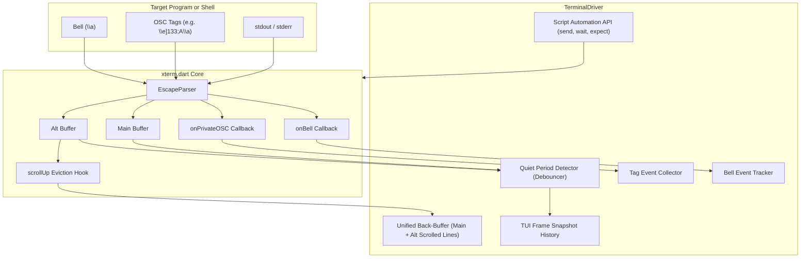

# Terminal Driver and Automation Architecture

This document describes the design for driving terminal automation, quiet period detection, special tag signaling, bell events, and capturing content from alternative buffer and TUI modes.

## Problem Statement

Automating interactive terminal sessions requires more than typing text into a PTY. Test scripts and AI agents need to:
1. Send keystrokes and text inputs programmatically.
2. Detect when an interactive program has finished outputting by monitoring quiet periods.
3. Observe special control signals like terminal bells (`\a` or `0x07`).
4. Receive structured out-of-band signals from programs via escape tags.
5. Retain a continuous record of everything displayed, even when programs switch to the alternative screen buffer or draw TUIs that normally discard scrolled lines.

## Analysis: Alternative Buffer and TUI Capture

### How Standard Terminals Handle Alternate Screens
Standard DEC/xterm terminal emulators provide two screen buffers:
- **Main Buffer**: Used for normal shell output. It maintains a large scrollback history. Lines pushed off the top enter the scrollback buffer.
- **Alternative Buffer (`CSI ? 1049 h`)**: Used by full-screen applications like `less`, `vim`, `man`, `fzf`, and `htop`. It has a fixed height equal to the visible viewport. It has no scrollback buffer. When an application exits (`CSI ? 1049 l`), the terminal switches back to the main buffer.

### Why TUI Content Gets Lost
Programs running in the alternative buffer interact with the screen in two ways:
1. **Scrolling Pagers and Streams (`less`, `git log`, `man`, vim scrolling)**:
   - When new content arrives at the bottom margin, the terminal executes `scrollUp(1)`.
   - The line at the top margin is shifted out of the array and replaced.
   - In standard terminals, this evicted line is permanently lost.
2. **In-Place Screen Redrawers (`htop`, `top`, dialog menus, curses UI)**:
   - These programs reposition the cursor (`CSI row ; col H`) and overwrite cells directly.
   - They do not scroll lines off the top.
   - When the screen updates or clears, older screen states are overwritten.

### How We Capture TUI and Alt-Buffer Content
We solve this with a two-part capture strategy:

1. **Eviction Capture (Stream Preservation)**:
   - We hook `Buffer.scrollUp(count)` in `lib/src/core/buffer/buffer.dart`.
   - Before any line is shifted off the top margin, we copy the line and dispatch it to an eviction listener.
   - In the alternative buffer, every line that scrolls off the top is appended to a shadow back-buffer.
   - `deleteLines` (`CSI M`) with the cursor on the top margin is treated as a scroll and evicts the deleted lines; deletions lower in the region edit in place and are not captured.
   - The hook is only installed while `Terminal.onLineScrolledOff` is set, so terminals without a driver pay nothing.
   - This ensures pagers and scrolling TUIs never lose scrolled content.

2. **Settled-State Frame Snapshots (State Preservation)**:
   - For in-place redrawers like `htop` or forms, lines do not scroll off.
   - Instead, the automation driver captures a snapshot of the visible text grid whenever the screen settles.
   - Screen snapshots are also captured immediately before `eraseDisplay()` clears the screen, and when exiting the alternative buffer.
   - This records every distinct screen state shown during the TUI session.

## Architecture

## Driver Components

### 1. Keystroke and Text Injection
The driver exposes high-level helpers:
- `send(String text)`: Feeds raw input into the terminal input stream via `Terminal.textInput`; the host wires `Terminal.onOutput` to the PTY, exactly as for keyboard input.
- `sendLine(String text)`: Feeds input followed by a carriage return.
- `sendKey(TerminalKey key, {bool ctrl, bool alt, bool shift})`: Sends terminal key sequences.

### 2. Quiet Period / Idle Detection
Terminal programs often write output in bursts or chunks.
The driver implements `waitForQuiet({Duration silence, Duration timeout})`:
- Each write to the terminal resets a silence timer.
- When no new output is received for the `silence` interval, the screen is declared settled.
- This reliably signals that the program has finished its current output batch and is waiting for user input.

### 3. Special Tag Signaling (OSC Tags)
Programs can send metadata and synchronization signals without polluting the visible grid:
- OSC escape sequences follow the format `\x1b]<code>;<payload>\x07`.
- Standard semantic prompt tags (OSC 133):
  - `\x1b]133;A\x07`: Prompt started.
  - `\x1b]133;B\x07`: Command input started.
  - `\x1b]133;C\x07`: Command output started.
  - `\x1b]133;D;<exit_code>\x07`: Command finished.
- Custom application tags (e.g. OSC 777):
  - `\x1b]777;tag;<name>;<value>\x07`
- `Terminal.onPrivateOSC` captures unrecognized OSC codes.
- The driver stores every tag event with timestamp, code, and arguments.
- Scripts can invoke `waitForTag(String code, {Pattern? argPattern, Duration timeout})`.

### 4. Bell Detection
- When a program emits ASCII `0x07` (`\a`), `Terminal.bell()` fires `Terminal.onBell`.
- The driver tracks the bell count and allows scripts to call `waitForBell({Duration timeout})`.

### 5. Unified Back-Buffer and Frame Recording
- **Captured Back-Buffer**: An append-only list of lines combining main buffer history and alt-buffer scrolled lines.
- **Screen Snapshots**: Saved 2D text frames recorded on screen settle, screen clear, or on-demand.
- Scripts can inspect the live screen, the scrollback history, or historical snapshots.
